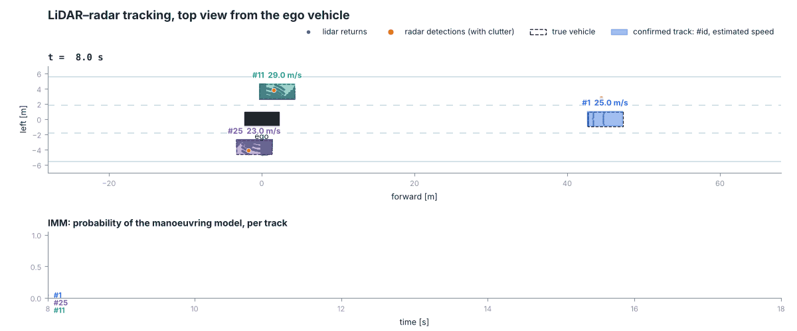
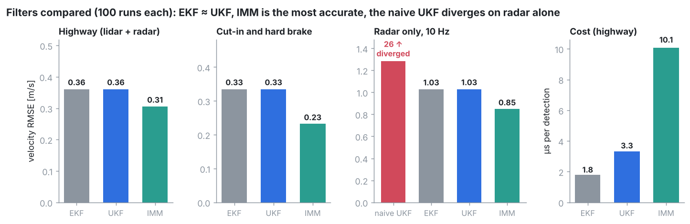

# LiDAR–Radar 3D Tracking

Multi-target vehicle tracking from LiDAR and radar in C++17 with Eigen.
Classical estimation throughout: an IMM of CTRV unscented Kalman filters,
χ² gating, Hungarian assignment, log-likelihood-ratio track management, and
an L-shape box detector on ray-cast LiDAR scans. A seeded highway simulator
with a moving ego vehicle measures every design choice over 100 runs.



*Realistic sensing (10 Hz scan LiDAR, 20 Hz radar, misses, clutter, no
labels). A car cuts in at 9.5 s and the lead car brakes at 13 s; the lower
panel shows the IMM switching each track to its manoeuvring model.*


## Algorithms

| Stage | Implemented | Compared against | Code |
|---|---|---|---|
| Motion model | CTRV (constant turn rate and velocity) | – | [models.h](include/fusion/models.h) |
| State estimation | IMM of two CTRV UKFs (cruising / manoeuvring) | UKF, EKF, textbook UKF | [filters/](include/fusion/filters) |
| UKF numerics | Scaled (Merwe) or Julier sigma points, circular means, Joseph form, LDLT, PD repair | textbook UKF | [ukf.h](include/fusion/filters/ukf.h) |
| Gating | χ² test on the innovation (99.9 %) | – | [tracker.h](include/fusion/tracking/tracker.h) |
| Association | Global nearest neighbour, Hungarian algorithm, confirmed tracks first | known labels | [hungarian.h](include/fusion/tracking/hungarian.h) |
| Track management | Log-likelihood-ratio score (confirm, coast, delete) | M-of-N hit count | [tracker.h](include/fusion/tracking/tracker.h) |
| Initialisation | Two detections ≥ 0.2 s apart, road-direction prior | single detection | [tracker.h](include/fusion/tracking/tracker.h) |
| LiDAR detection | Grid clustering, L-shape fit on the visible contour, size completion | centroid of returns | [lidar_scanner.h](include/fusion/sim/lidar_scanner.h) |
| Simulation | Kinematic bicycle traffic, 64-beam ray-cast LiDAR, radar with clutter and misses | – | [sim/](include/fusion/sim) |
| Evaluation | RMSE, NEES, NIS, OSPA, ID switches, false tracks | – | [metrics.h](include/fusion/eval/metrics.h) |

Why each was chosen, and the trade-offs, are in [docs/DESIGN.md](docs/DESIGN.md).

## Results

Means over 100 seeded runs.

| | Naive UKF tracker | This pipeline |
|---|---|---|
| Velocity RMSE vx / vy, highway [m/s] | 0.222 / 0.322 | **0.145 / 0.269** |
| Filter consistency (NEES, ideal 2) | 2.51 | **2.02** |
| Radar only at 10 Hz, vx RMSE [m/s] | 18.3 (diverges) | **0.27** |
| Stalled car in traffic, ID switches per run | 39 | **0** |
| False tracks at 20 clutter detections per frame (hit count vs score) | 2.9 | **0** |
| Lidar detection error, median (centroid vs box) [m] | 1.67 | **0.06** |

Under realistic sensing, GNN association comes within 5 % of known labels
(OSPA 0.081 m against 0.077 m), with no identity switches.




## Build

Ubuntu 22.04 or 24.04:

```bash
sudo apt install cmake g++ libeigen3-dev libyaml-cpp-dev libgtest-dev
cmake -S . -B build && cmake --build build -j
ctest --test-dir build
```

The 3D viewer is built when PCL is installed (`libpcl-dev`).

**API reference:** install `doxygen`, then run `cmake --build build --target doc`
and open `build/doc/html/index.html`.

## Run

```bash
./build/fusion_run --config config/realistic.yaml --out output/run    # one run, metrics + CSVs
./build/fusion_bench --runs 100 config/experiments/2_filters/*.yaml   # Monte Carlo comparison
./build/fusion_viewer --config config/demo.yaml                       # interactive 3D view
python3 scripts/animate_run.py output/run tracking.gif                # top-view animation
```

Every parameter is in [config/default.yaml](config/default.yaml). Override
files change only the keys they list, can include other files, and unknown
keys are rejected.

## Library use

```cpp
#include "fusion/config.h"
#include "fusion/tracking/tracker.h"

fusion::MultiTargetTracker tracker(fusion::loadConfig("config/default.yaml"));
tracker.process(time, fusion::Sensor::Radar, detections, ego_pose);  // one sensor frame
for (const fusion::Track& t : tracker.tracks())
    if (t.confirmed) { /* t.id, t.filter->state(), t.filter->covariance() */ }
```

## Layout

```
include/fusion/   public API (Doxygen)
src/              implementation
apps/             fusion_run, fusion_bench, fusion_viewer
tests/            GoogleTest unit and regression tests
config/           defaults, scenarios, experiments
scripts/          experiments, figures and the animation
docs/             design notes and figures
```

## License

[MIT](LICENSE)
