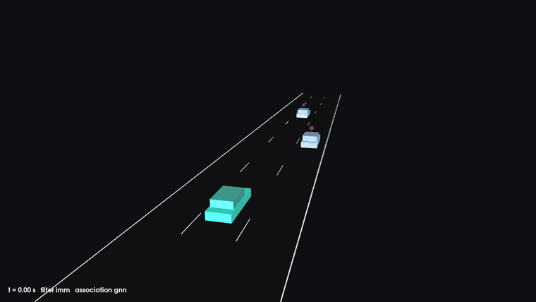
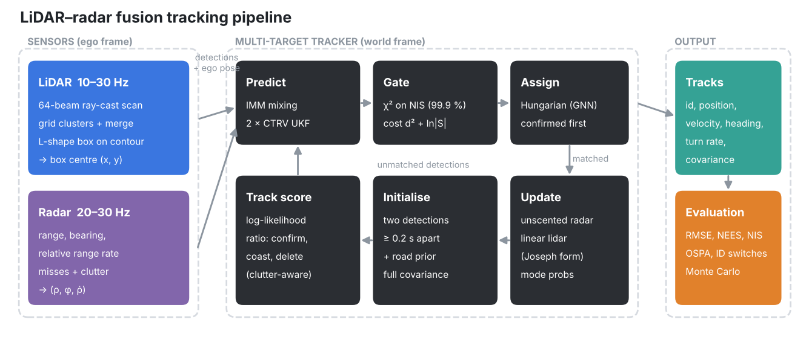

# LiDAR–Radar 3D Tracking

Multi-target vehicle tracking from LiDAR and radar in C++17 with Eigen.
It runs an IMM filter over CTRV unscented Kalman filters, uses global
nearest-neighbour association (Hungarian algorithm) with χ² gating, and
manages tracks with a log-likelihood-ratio score. LiDAR detections come from
L-shape boxes fitted to ray-cast point clouds. A seeded highway simulator
with a moving ego vehicle measures every design choice.





## Results

Means over 100 seeded runs. Full numbers and trade-offs are in
[docs/DESIGN.md](docs/DESIGN.md).

| | Naive UKF tracker | This pipeline |
|---|---|---|
| Velocity RMSE vx / vy, highway [m/s] | 0.222 / 0.322 | **0.145 / 0.269** |
| Filter consistency (NEES, ideal 2) | 2.51 | **2.02** |
| Radar only at 10 Hz, vx RMSE [m/s] | 18.3 (diverges) | **0.27** |
| Stalled car in traffic, ID switches per run | 39 | **0** |
| False tracks at 20 clutter detections per frame (hit count vs score) | 2.9 | **0** |
| Lidar detection error, median (centroid vs box) [m] | 1.67 | **0.06** |

Under realistic sensing, GNN association comes within 5 % of known labels
(OSPA 0.081 m against 0.077 m), with no identity switches.

## Build

Ubuntu 22.04 or 24.04:

```bash
sudo apt install cmake g++ libeigen3-dev libyaml-cpp-dev libgtest-dev
cmake -S . -B build && cmake --build build -j
ctest --test-dir build
```

The 3D viewer is built when PCL is installed (`libpcl-dev`).

**API reference:** install `doxygen`, then run `cmake --build build --target doc`
and open `build/doc/html/index.html`.

## Run

```bash
./build/fusion_run --config config/realistic.yaml --out output/run    # one run, metrics + CSVs
./build/fusion_bench --runs 100 config/experiments/2_filters/*.yaml   # Monte Carlo comparison
./build/fusion_viewer --config config/realistic.yaml                  # 3D view
```

Every parameter is in [config/default.yaml](config/default.yaml). Override
files change only the keys they list, can include other files, and unknown
keys are rejected.

## Library use

```cpp
#include "fusion/config.h"
#include "fusion/tracking/tracker.h"

fusion::MultiTargetTracker tracker(fusion::loadConfig("config/default.yaml"));
tracker.process(time, fusion::Sensor::Radar, detections, ego_pose);  // one sensor frame
for (const fusion::Track& t : tracker.tracks())
    if (t.confirmed) { /* t.id, t.filter->state(), t.filter->covariance() */ }
```

## Layout

```
include/fusion/   public API (Doxygen)
src/              implementation
apps/             fusion_run, fusion_bench, fusion_viewer
tests/            GoogleTest unit and regression tests
config/           defaults, scenarios, experiments
scripts/          experiment runner and figures
docs/             design notes and figures
```

## License

[MIT](LICENSE)
