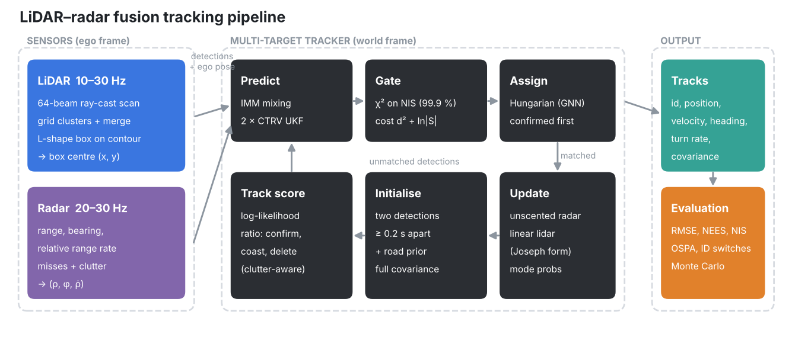
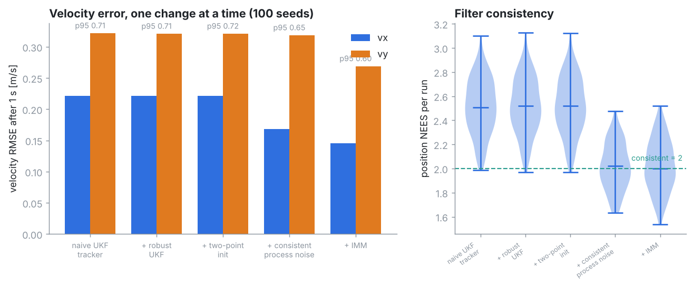
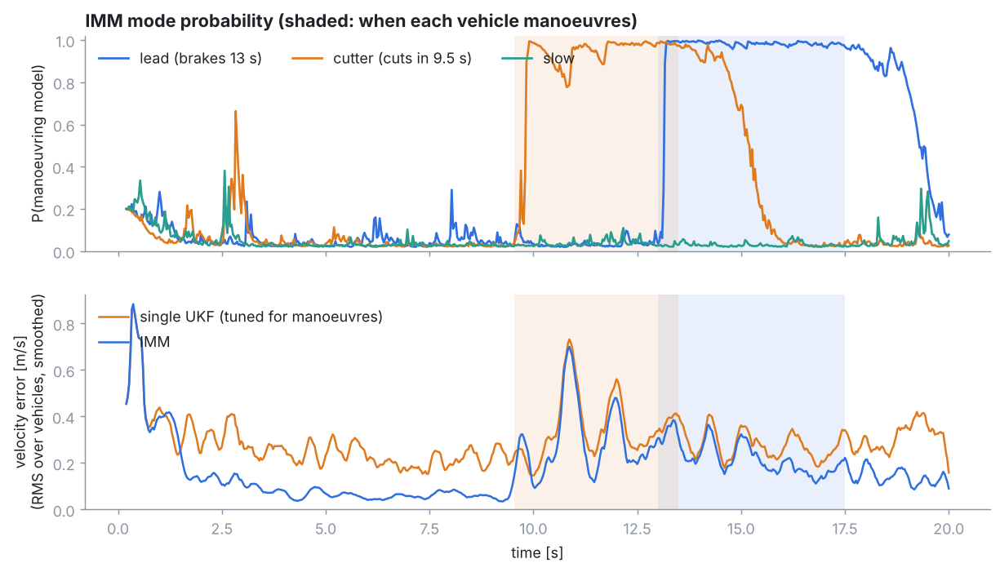
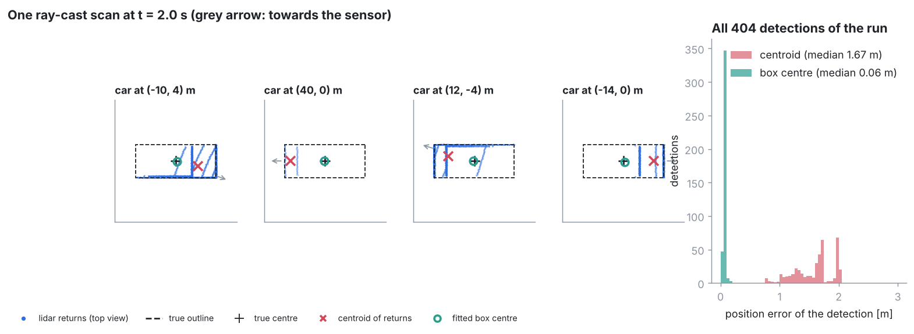
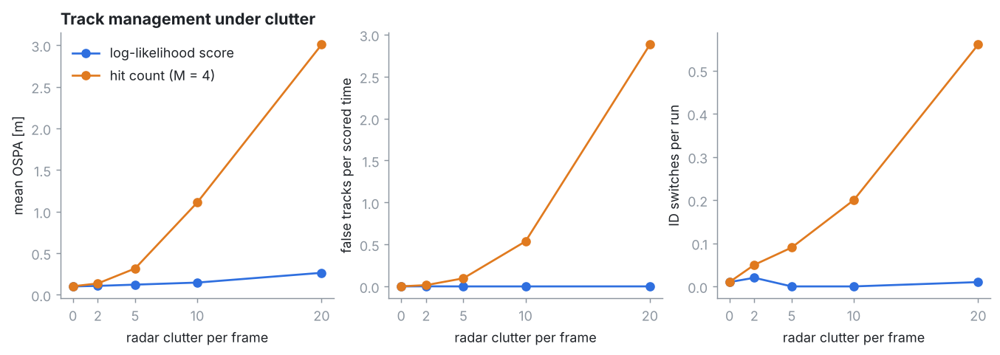

# Design

How the tracker works, why each algorithm was chosen, and what the
measurements say. All numbers are means over 100 seeded runs
(`scripts/run_experiments.sh`). The comparison point is a **naive
tracker**: one textbook UKF per vehicle, hand-tuned noise, a single-detection
start, and known association (`config/naive.yaml`).

## Pipeline

Each call to `MultiTargetTracker::process(time, sensor, detections, ego)`
handles one sensor frame:

1. **Predict** every track to the frame time.
2. **Gate:** a pair is allowed if d² = yᵀS⁻¹y is below the 99.9 % χ² quantile.
   The cost is d² + ln|S| (a negative log-likelihood).
3. **Assign** with the Hungarian algorithm, confirmed tracks first.
4. **Update** the matched filters.
5. **Initialise** tracks from pairs of leftover detections.
6. **Score** every track with a log-likelihood ratio, and confirm or delete
   it.

Tracks live in the **world frame**. Detections arrive in the **ego frame**
with the ego pose attached, and the measurement models are ego-relative. The
radar range rate uses the velocity relative to the ego vehicle.

## Decisions

| Decision | Choice | Alternatives | Evidence |
|---|---|---|---|
| Frame | World frame, ego-relative measurement models | Ego frame | Motion models describe real motion; process noise stays small and consistent |
| Motion model | CTRV | CV, CTRA | Heading and turn rate predict lane changes; the IMM absorbs accelerations |
| Estimator | IMM of two CTRV UKFs (cruising σa 0.3, σψ̈ 0.02; manoeuvring σa 3, σψ̈ 0.5) | UKF, EKF | −14 % vx, −16 % vy on the highway; −33 % / −30 % on the cut-in |
| UKF numerics | Circular means, fresh sigma points per update, Joseph form, LDLT, PD repair | Naive UKF | Radar-only at 10 Hz the naive UKF diverges (18 m/s RMSE against 0.27) |
| Process noise | Chosen for NEES ≈ 2 and NIS ≈ dof | Hand-tuned | NEES 2.5 → 2.0 and −24 % vx |
| Initialisation | Two detections ≥ 0.2 s apart, full covariance, road-direction prior | Single detection | With a stalled car: 0 ID switches against 39 per run |
| Association | GNN (Hungarian), confirmed tracks first | JPDA, MHT | Within 5 % of known labels under realistic sensing |
| Track management | Log-likelihood-ratio score | Hit count | 0 false tracks at 20 clutter detections per frame, against 2.9 |
| Lidar detection | L-shape fit on the visible contour, completed to vehicle size, cabin-aware under occlusion | Centroid | Median error 0.06 m against 1.67 m |

**Trade-offs worth knowing:**
- **EKF and UKF tie everywhere tested.** With a precise radar the models are
  nearly linear over the uncertainty. The EKF runs at half the cost (2.1 µs
  against 3.8 µs per detection).
- **The IMM's mode probabilities are sticky.** The switching rate of 0.1 /s
  delays the return to the cruising model after a manoeuvre; a higher rate
  makes cruising noisier.
- **Pairing detections after 50 ms instead of 0.2 s** confirms tracks 0.13 s
  sooner (lower OSPA) but gives slightly worse velocities.
- **The track score confirms a little later in heavy clutter:** 0.80 s
  against 0.66 s at 20 clutter detections per frame.
- **The lidar box detector's error is correlated in time.** Declaring its
  true noise (0.08 m) to the filter lowers vy error by 25 % but makes the
  filter overconfident (NEES 3.0), so the default declares 0.15 m.

## Results

| Highway scenario, known association | vx / vy RMSE [m/s] | velocity p95 | NEES |
|---|---|---|---|
| Naive UKF tracker | 0.222 / 0.322 | 0.71 | 2.51 |
| + robust UKF and two-point start | 0.222 / 0.321 | 0.72 | 2.52 |
| + consistent process noise | 0.168 / 0.319 | 0.65 | 2.02 |
| + IMM (this pipeline) | **0.145 / 0.269** | **0.60** | 2.02 |

The robust UKF and the two-point start change nothing in this clean case.
They matter where the naive versions fail: radar-only operation, and objects
that do not move like the ego vehicle.

| Realistic sensing (scan lidar 10 Hz, radar 20 Hz, misses, clutter) | OSPA [m] | ID switches / run | false tracks |
|---|---|---|---|
| Known labels | 0.077 | 0 | 0 |
| **GNN + IMM (default)** | **0.081** | **0** | **0** |
| Naive UKF inside the same tracker | 0.110 | 0.24 | 0.006 |
| Centroid instead of box detector | 3.417 | 1.95 | 3.55 |

**Runtime** (one 2.1 GHz core, per detection):

| Configuration | Time |
|---|---|
| EKF | 2.1 µs |
| UKF | 3.8 µs |
| IMM | 12.1 µs |
| Full tracker under clutter | 40 µs |

## Limitations

- **Simulated data only.** The simulation has no ground returns, multipath
  or weather, and vehicles are boxes.
- **Perfect ego odometry.**
- **Straight road.** The road prior and the detector's cabin rule assume
  traffic moves in the ego vehicle's direction.
- **Few vehicles.** Dense crossing traffic would favour JPDA or MHT.
- **Fixed vehicle size** in the box detector.

## References

- Blackman & Popoli, *Design and Analysis of Modern Tracking Systems*, 1999:
  track score, gating.
- Bar-Shalom, Li & Kirubarajan, *Estimation with Applications to Tracking
  and Navigation*, 2001: NEES/NIS, IMM.
- Julier & Uhlmann, "Unscented filtering and nonlinear estimation",
  Proc. IEEE, 2004.
- Zhang et al., "Efficient L-shape fitting for vehicle detection using laser
  scanners", IEEE IV, 2017.
- Schuhmacher, Vo & Vo, "A consistent metric for performance evaluation of
  multi-object filters", IEEE TSP, 2008 (OSPA).
